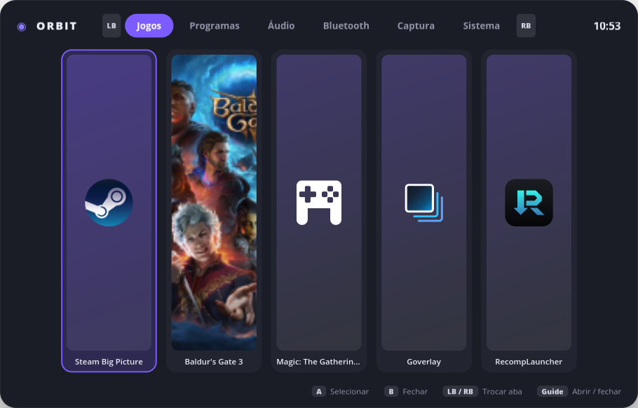
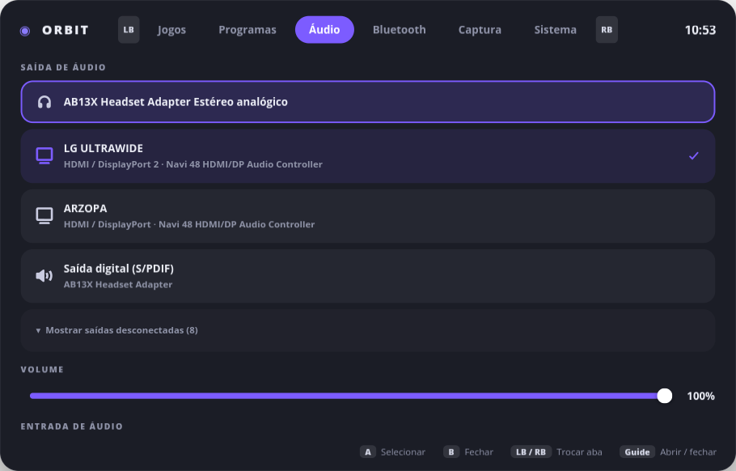
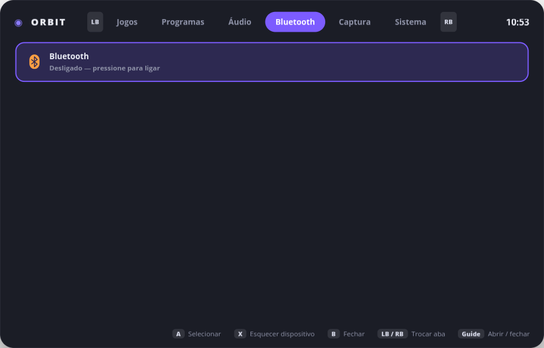
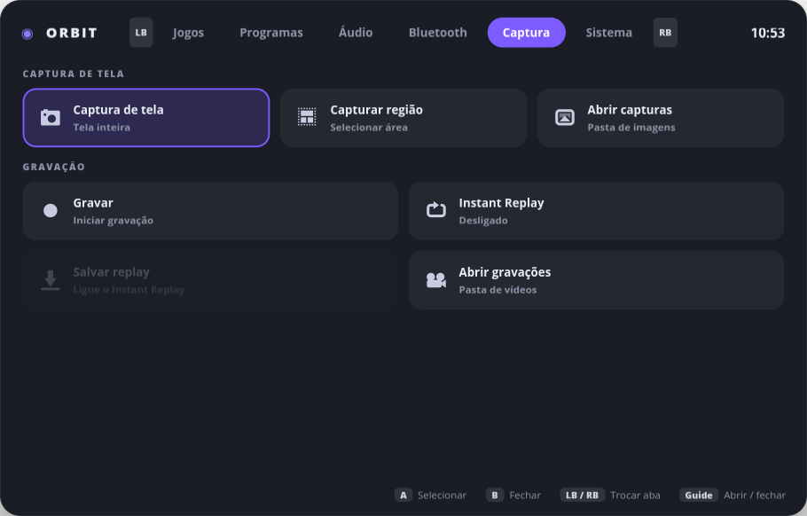

<div align="center">

# ◉ Orbit

**Uma "Game Bar" para Linux, feita para o controle.**

Aperte o botão **Guide** (o do meio) e um painel aparece por cima de tudo, inclusive de
jogos em tela cheia, para abrir jogos, fechar programas, trocar o som, parear um fone
Bluetooth ou tirar um print, sem largar o controle.



</div>

---

## Sumário

- [Recursos](#recursos)
- [Capturas de tela](#capturas-de-tela)
- [Controles](#controles)
- [Ambientes gráficos suportados](#ambientes-gráficos-suportados)
- [Instalação](#instalação)
- [Uso](#uso)
- [Configuração recomendada](#configuração-recomendada)
- [Desempenho](#desempenho)
- [Solução de problemas](docs/solucao-de-problemas.md)
- [Arquitetura e desenvolvimento](docs/arquitetura.md)
- [Licença](#licença)

## Recursos

| Aba | O que faz |
|---|---|
| **Jogos** | Steam Big Picture, jogos da Steam com capa (os jogados recentemente primeiro) e jogos instalados por `.desktop` (Heroic, Lutris, nativos…) |
| **Programas** | Todas as janelas abertas. **A** alterna para ela, **X** fecha |
| **Áudio** | **Todas** as saídas e entradas, inclusive as que exigem trocar o perfil da placa (como o 2º monitor HDMI de uma placa de vídeo), volume de saída e do microfone, mudo |
| **Bluetooth** | Liga/desliga (desbloqueia o rfkill se preciso), procura, pareia, conecta/desconecta e esquece dispositivos. Códigos de pareamento aparecem na tela com Confirmar/Cancelar |
| **Captura** | Print da tela inteira ou de uma região, gravação de tela e **Instant Replay** (salva os últimos 30 s) |
| **Sistema** | Configurações, Arquivos, Bloquear, Suspender, Reiniciar, Desligar |

## Capturas de tela

<table>
  <tr>
    <td><br><sub><b>Programas</b>: alterne ou feche qualquer janela pelo controle</sub></td>
    <td><br><sub><b>Áudio</b>: todas as saídas, inclusive cada monitor HDMI</sub></td>
  </tr>
  <tr>
    <td><br><sub><b>Bluetooth</b>: ligue, procure e pareie dispositivos</sub></td>
    <td><br><sub><b>Captura</b>: prints, gravação e Instant Replay</sub></td>
  </tr>
  <tr>
    <td><br><sub><b>Sistema</b>: atalhos e energia</sub></td>
    <td><br><sub><b>Jogos</b>: biblioteca da Steam e outros launchers</sub></td>
  </tr>
</table>

> As capturas são geradas pelo próprio Orbit com `orbit --render-docs docs/screenshots`.

## Controles

| Botão | Ação |
|---|---|
| **Guide** | abre / fecha o Orbit |
| **D-pad / analógico esquerdo** | navega (segure para repetir) |
| **A** | seleciona |
| **B** | fecha |
| **X** | *Programas*: fecha o programa · *Bluetooth*: esquece o dispositivo |
| **LB / RB** | troca de aba |
| **← / →** num controle deslizante | volume ±5 % |

Teclado e mouse também funcionam: setas, Enter, Esc, ou clique fora do painel para fechar.

Enquanto o Orbit está aberto o controle fica **exclusivo dele** (o jogo não recebe os
botões de navegação). Ao fechar, volta para o jogo.

Cada aba lembra onde o cursor estava. Se o item some (um programa fechou, um fone
desconectou), o cursor vai para o vizinho e não se perde.

## Ambientes gráficos suportados

| Ambiente | Overlay por cima de jogos | Programas abertos | Captura de tela |
|---|:---:|:---:|---|
| **COSMIC** | ✅ | ✅ | `cosmic-screenshot` |
| **KDE Plasma** (Wayland) | ✅ | ✅ | `spectacle` |
| **Hyprland, Sway, niri, labwc, Wayfire, river** | ✅ | ✅ | `grim` + `slurp` |
| **GNOME** (Wayland) | janela em tela cheia¹ | ❌² | `gnome-screenshot` / portal |
| **X11** (XFCE, Cinnamon, MATE, KDE/GNOME em X11…) | janela em tela cheia¹ | ✅ | `maim` / `scrot` / portal |

¹ O overlay de verdade usa o protocolo *layer-shell*, que o GNOME e o X11 não têm. Lá o
Orbit abre como uma janela em tela cheia comum.<br>
² O GNOME não permite que aplicativos listem as janelas abertas.

Áudio (PipeWire ou PulseAudio), Bluetooth (BlueZ) e o controle (evdev) funcionam em
qualquer ambiente. Sem nenhuma ferramenta de captura instalada, o Orbit pede o print ao
`xdg-desktop-portal`.

## Instalação

### 1. Dependências

| | Arch / CachyOS / Manjaro | Fedora | Debian / Ubuntu |
|---|---|---|---|
| Compilação | `rust gtk4 pkgconf` | `rust cargo gtk4-devel` | `cargo libgtk-4-dev pkg-config` |
| Overlay (recomendado) | `gtk4-layer-shell` | `gtk4-layer-shell-devel` | `libgtk4-layer-shell-dev` |
| Áudio | `libpulse` (`pactl`) | `pulseaudio-utils` | `pulseaudio-utils` |
| Gravação / replay (opcional) | `gpu-screen-recorder` | `gpu-screen-recorder` (COPR) | [gpu-screen-recorder](https://git.dec05eba.com/gpu-screen-recorder/about/) |
| Bluetooth (opcional) | `bluez` | `bluez` | `bluez` |

Exemplo no Arch/CachyOS:

```sh
sudo pacman -S --needed rust gtk4 pkgconf gtk4-layer-shell libpulse bluez gpu-screen-recorder
```

### 2. Compilar e instalar

```sh
git clone https://github.com/RafaelMendes1407/orbit.git
cd orbit
./install.sh
```

O script:

1. compila em modo release (sem o `gtk4-layer-shell`, compila no modo janela e avisa);
2. instala em `~/.local/bin/orbit` (sem root);
3. coloca o Orbit no autostart da sessão (`orbit --daemon`);
4. reinicia a instância que estiver rodando.

Para remover: `./uninstall.sh`.

### 3. Permissão para ler o controle

O Orbit lê o controle direto do kernel (`/dev/input/event*`). Na maioria das distros
com systemd, o usuário logado já tem acesso aos controles (regra *uaccess*). Se o Guide
não fizer nada, veja [Solução de problemas](docs/solucao-de-problemas.md#o-botão-guide-não-abre-nada).

## Uso

```text
orbit                 abre/fecha o painel (inicia se preciso)
orbit --daemon        inicia em segundo plano, escondido
orbit --quit          encerra a instância em execução
orbit --list-windows  mostra o backend e as janelas detectadas (diagnóstico)
orbit --list-audio    mostra as saídas/entradas que a aba Áudio vai listar
orbit --render-docs D gera as capturas de tela de cada aba em D/
```

### Atalho de teclado (opcional)

Crie um atalho com o comando `orbit` (ex.: <kbd>Super</kbd>+<kbd>G</kbd>):

| Ambiente | Onde |
|---|---|
| COSMIC | Configurações → Teclado → Atalhos de teclado → Atalhos personalizados |
| KDE Plasma | Configurações do sistema → Atalhos → Adicionar comando |
| GNOME | Configurações → Teclado → Atalhos personalizados |
| Hyprland | `bind = SUPER, G, exec, orbit` no `hyprland.conf` |
| Sway | `bindsym $mod+g exec orbit` no `config` |

### Onde ficam os arquivos

| O quê | Pasta |
|---|---|
| Capturas de tela | `~/Imagens/Screenshots` |
| Gravações | `~/Vídeos/Orbit` |
| Instant Replay | `~/Vídeos/Orbit/Replays` |

## Configuração recomendada

- **Steam aberta:** a Steam também usa o botão Guide. Para ele abrir só o Orbit, vá em
  *Steam → Configurações → Controle* e desative **"O botão Guia foca a Steam"**.
- **Instant Replay** e **gravação** usam o `gpu-screen-recorder`, que grava pelo encoder
  da GPU e custa quase nada de desempenho.
- **Áudio:** saídas desconectadas (portas sem nada plugado) ficam escondidas em
  *"▾ Mostrar saídas desconectadas"*. Escolher uma saída que precisa de outro perfil
  troca o perfil da placa e tenta manter o microfone que estava ativo.

## Desempenho

- Binário nativo em **Rust + GTK4**, cerca de **75 MB de RAM** residente (boa parte é
  biblioteca compartilhada) e **0 % de CPU** parado.
- Fica residente com a janela já montada, então abrir é só mostrar a superfície (instantâneo).
- Controle, janelas e Bluetooth são lidos por eventos: as threads dormem até o kernel,
  o compositor ou o BlueZ avisarem algo. Nada fica consultando em loop.
- Capas da Steam são decodificadas já no tamanho final e guardadas em cache.
- A busca Bluetooth só roda com a aba Bluetooth aberta.

## Licença

[GPL-3.0-or-later](LICENSE). O Orbit usa a biblioteca
[`cosmic-protocols`](https://github.com/pop-os/cosmic-protocols) (GPL-3.0) para o suporte ao COSMIC.
