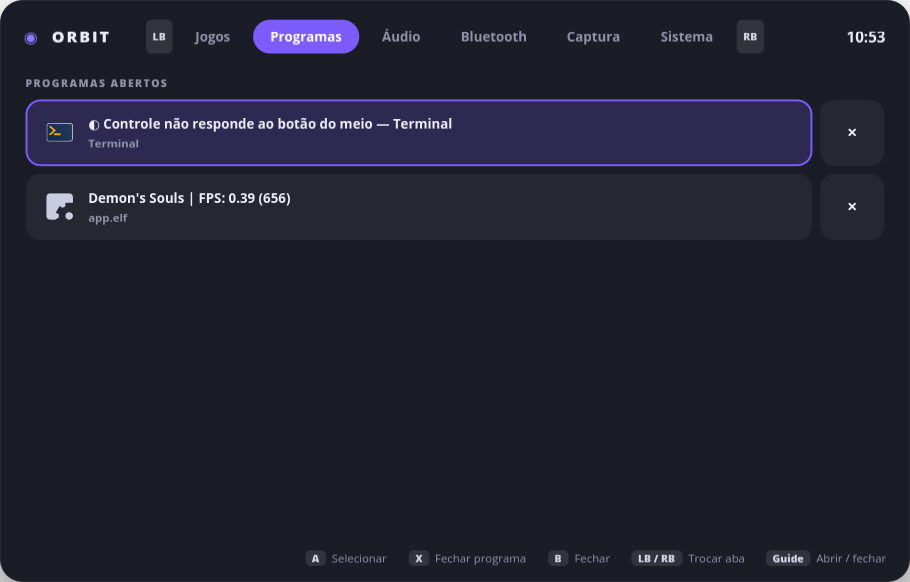
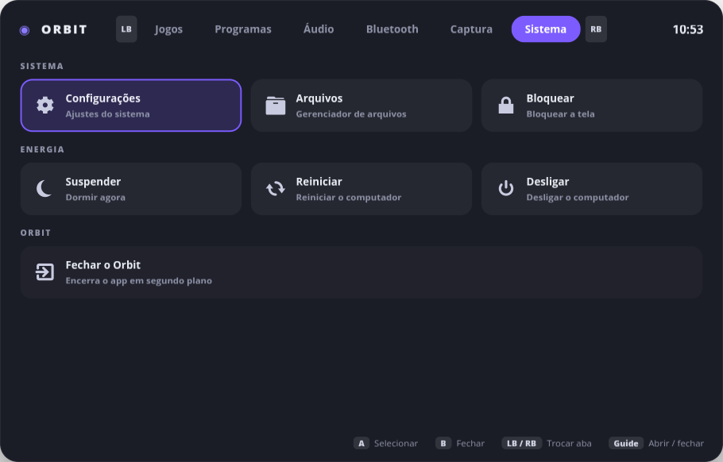

<div align="center">

# ◉ Orbit

**A "Game Bar" for Linux, built for the gamepad.**

Press the **Guide** button (the middle one) and a panel appears on top of everything, even
fullscreen games. From there you can launch games, close programs, switch audio devices,
pair a Bluetooth headset or take a screenshot, without putting the controller down.


</div>

> **Note:** the interface is currently in Brazilian Portuguese, which is why the
> screenshots show Portuguese labels.

---

## Contents

- [Features](#features)
- [Screenshots](#screenshots)
- [Controls](#controls)
- [Supported desktops](#supported-desktops)
- [Installation](#installation)
- [Usage](#usage)
- [Recommended setup](#recommended-setup)
- [Performance](#performance)
- [Troubleshooting](docs/troubleshooting.md)
- [Architecture and development](docs/architecture.md)
- [License](#license)

## Features

| Tab | What it does |
|---|---|
| **Games** (*Jogos*) | Steam Big Picture, Steam games with cover art (most recently played first) and games installed through `.desktop` files (Heroic, Lutris, native…) |
| **Programs** (*Programas*) | Every open window. **A** switches to it, **X** closes it |
| **Audio** (*Áudio*) | **Every** output and input, including those that need a different card profile (such as the second HDMI monitor on a graphics card), output and microphone volume, mute |
| **Bluetooth** | Turn on/off (lifts the rfkill soft block if needed), scan, pair, connect/disconnect and forget devices. Pairing codes are shown on screen with Confirm/Cancel |
| **Capture** (*Captura*) | Full-screen or region screenshots, screen recording and **Instant Replay** (saves the last 30 s) |
| **System** (*Sistema*) | Settings, Files, Lock, Suspend, Restart, Shut down |

## Screenshots

<table>
  <tr>
    <td><br><sub><b>Programs</b>: switch to or close any window with the controller</sub></td>
    <td><br><sub><b>Audio</b>: every output, including each HDMI monitor</sub></td>
  </tr>
  <tr>
    <td><br><sub><b>Bluetooth</b>: turn on, scan and pair devices</sub></td>
    <td><br><sub><b>Capture</b>: screenshots, recording and Instant Replay</sub></td>
  </tr>
  <tr>
    <td><br><sub><b>System</b>: shortcuts and power</sub></td>
    <td><br><sub><b>Games</b>: Steam library and other launchers</sub></td>
  </tr>
</table>

> The screenshots are generated by Orbit itself with `orbit --render-docs docs/screenshots`.

## Controls

| Button | Action |
|---|---|
| **Guide** | open / close Orbit |
| **D-pad / left stick** | navigate (hold to repeat) |
| **A** | select |
| **B** | close |
| **X** | *Programs*: close the program · *Bluetooth*: forget the device |
| **LB / RB** | switch tab |
| **← / →** on a slider | volume ±5 % |

Keyboard and mouse work too: arrow keys, Enter, Esc, or click outside the panel to close it.

While Orbit is open it takes **exclusive control** of the gamepad, so the game doesn't
receive the navigation buttons. When you close it, the gamepad goes back to the game.

Each tab remembers where the cursor was. If the item goes away (a program closed, a
headset disconnected), the cursor moves to its neighbour instead of getting lost.

## Supported desktops

| Desktop | Overlay on top of games | Open programs | Screenshots |
|---|:---:|:---:|---|
| **COSMIC** | ✅ | ✅ | `cosmic-screenshot` |
| **KDE Plasma** (Wayland) | ✅ | ✅ | `spectacle` |
| **Hyprland, Sway, niri, labwc, Wayfire, river** | ✅ | ✅ | `grim` + `slurp` |
| **GNOME** (Wayland) | fullscreen window¹ | ❌² | `gnome-screenshot` / portal |
| **X11** (XFCE, Cinnamon, MATE, KDE/GNOME on X11…) | fullscreen window¹ | ✅ | `maim` / `scrot` / portal |

¹ The real overlay uses the *layer-shell* protocol, which GNOME and X11 don't have. There,
Orbit opens as a regular fullscreen window.<br>
² GNOME doesn't let applications list the open windows.

Audio (PipeWire or PulseAudio), Bluetooth (BlueZ) and the gamepad (evdev) work on any
desktop. If no screenshot tool is installed, Orbit asks `xdg-desktop-portal` for the
screenshot.

## Installation

### 1. Dependencies

| | Arch / CachyOS / Manjaro | Fedora | Debian / Ubuntu |
|---|---|---|---|
| Build | `rust gtk4 pkgconf` | `rust cargo gtk4-devel` | `cargo libgtk-4-dev pkg-config` |
| Overlay (recommended) | `gtk4-layer-shell` | `gtk4-layer-shell-devel` | `libgtk4-layer-shell-dev` |
| Audio | `libpulse` (`pactl`) | `pulseaudio-utils` | `pulseaudio-utils` |
| Recording / replay (optional) | `gpu-screen-recorder` | `gpu-screen-recorder` (COPR) | [gpu-screen-recorder](https://git.dec05eba.com/gpu-screen-recorder/about/) |
| Bluetooth (optional) | `bluez` | `bluez` | `bluez` |

Example on Arch/CachyOS:

```sh
sudo pacman -S --needed rust gtk4 pkgconf gtk4-layer-shell libpulse bluez gpu-screen-recorder
```

### 2. Build and install

```sh
git clone https://github.com/RafaelMendes1407/orbit.git
cd orbit
./install.sh
```

The script:

1. builds in release mode (without `gtk4-layer-shell` it builds the window mode and tells you);
2. installs to `~/.local/bin/orbit` (no root needed);
3. adds Orbit to session autostart (`orbit --daemon`);
4. restarts any running instance.

To uninstall: `./uninstall.sh`.

### 3. Permission to read the gamepad

Orbit reads the gamepad straight from the kernel (`/dev/input/event*`). On most systemd
distributions the logged-in user already has access to gamepads (the *uaccess* rule).
If Guide does nothing, see [Troubleshooting](docs/troubleshooting.md#the-guide-button-does-nothing).

## Usage

```text
orbit                 open/close the panel (starts it if needed)
orbit --daemon        start in the background, hidden
orbit --quit          stop the running instance
orbit --list-windows  show the window backend and the detected windows (diagnostics)
orbit --list-audio    show the outputs/inputs the Audio tab will list
orbit --render-docs D render a screenshot of every tab into D/
```

### Keyboard shortcut (optional)

Create a shortcut that runs `orbit` (e.g. <kbd>Super</kbd>+<kbd>G</kbd>):

| Desktop | Where |
|---|---|
| COSMIC | Settings → Keyboard → Keyboard shortcuts → Custom shortcuts |
| KDE Plasma | System Settings → Shortcuts → Add command |
| GNOME | Settings → Keyboard → Custom shortcuts |
| Hyprland | `bind = SUPER, G, exec, orbit` in `hyprland.conf` |
| Sway | `bindsym $mod+g exec orbit` in `config` |

### Where files go

Folder names follow your XDG user directories, so they are localized (e.g. `~/Imagens`
on a Portuguese system).

| What | Folder |
|---|---|
| Screenshots | `~/Pictures/Screenshots` |
| Recordings | `~/Videos/Orbit` |
| Instant Replay | `~/Videos/Orbit/Replays` |

## Recommended setup

- **Steam running:** Steam also uses the Guide button. To make it open only Orbit, go to
  *Steam → Settings → Controller* and turn off **"Guide button focuses Steam"**.
- **Instant Replay** and **recording** use `gpu-screen-recorder`, which records with the
  GPU encoder and has almost no performance cost.
- **Audio:** outputs with nothing plugged in are tucked away under
  *"▾ Show disconnected outputs"*. Picking an output that needs a different profile
  switches the card profile and tries to keep the microphone that was active.

## Performance

- Native **Rust + GTK4** binary, about **75 MB of resident memory** (much of it shared
  libraries) and **0 % CPU** when idle.
- Stays resident with the window already built, so opening it just shows the surface
  (instant).
- Gamepad, windows and Bluetooth are event-driven: threads sleep until the kernel, the
  compositor or BlueZ report something. Nothing polls in a loop.
- Steam covers are decoded straight to their final size and cached.
- Bluetooth scanning only runs while the Bluetooth tab is open.

## License

[GPL-3.0-or-later](LICENSE). Orbit uses the
[`cosmic-protocols`](https://github.com/pop-os/cosmic-protocols) library (GPL-3.0) for COSMIC support.
